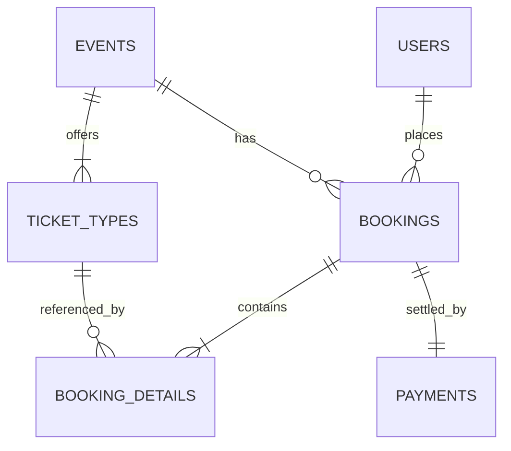

# 🎟️ Smart Event & Ticket Booking System

A full-stack campus event discovery, ticket booking, and live organizer analytics web application built around **Relational Database Management System (DBMS)** principles. Powered by **HTML5, CSS3, Vanilla JavaScript (ES6+), Node.js, Express.js**, and an embedded **SQLite 3** relational database featuring **Third Normal Form (3NF)** design, foreign key enforcement, and **ACID transaction safety**.

---

## 📖 Project Overview

**SmartEvent** enables college students to discover campus concerts, 36-hour hackathons, technical workshops, TEDx talks, and esports finals, sign in to their student account, book multi-tier passes with live seat tracking, and download a verified **single-page A4 QR E-Ticket PDF**. Simultaneously, event organizers can sign in through a dedicated **Admin Portal** to monitor live ticket counts, seat occupancy, revenue, and attendee orders across all events.

---

## ✨ Key Features

- **Joyful Campus Festival Interface (`index.html`):** Responsive light-festival UI with live keyword search, 5 category filters, and sorting by date, price, or popularity.
- **Dedicated Customer Sign-In & Sign-Up Tab (`login.html`):** Opens in a separate browser tab where students can register or sign in, auto-filling checkout details (Name, Roll No, Email, Phone) and syncing a personal **My Bookings** pass history across tabs.
- **Dedicated Admin Login & Live Analytics Tab (`admin.html`):** Opens in its own separate browser tab unlocking real-time SQL aggregate KPIs (**Total Tickets Booked**, **Confirmed Orders**, **Total Revenue**, **Seats Remaining**), per-event booked counts, and all customer bookings.
- **Multi-Tier Ticket Selection & Live Pricing:** Supports Student, General, and VIP ticket categories with automatic subtotal, campus service fee, and total calculation.
- **Real-Time Seat Inventory & Overbooking Prevention:** Live capacity progress bars and server-side validation preventing bookings that exceed tier or event capacity.
- **ACID Transaction & Rollback Safety:** Every booking executes inside an atomic SQLite transaction (`db.transaction(...)`). Any validation or constraint failure rolls back all changes cleanly with zero partial records.
- **Single-Page A4 QR E-Ticket PDF Export:** Generates an official campus pass with QR code, student details, event details, and unique `SEB-YYYY-XXXX` booking reference styled via `@media print` to fit cleanly on **1 A4 page**.

---

## 🛠️ Technologies Used

| Layer | Technology | Purpose |
| :--- | :--- | :--- |
| **Frontend** | HTML5, CSS3, JavaScript (ES6+) | Responsive UI, separate Customer & Admin tabs, cross-tab live sync, and single-page `@media print` A4 PDF ticket layout |
| **Backend** | Node.js, Express.js (`^4.21.2`) | REST API endpoints, authentication, input validation, static file serving, and transaction orchestration |
| **Database** | SQLite 3 (`better-sqlite3 ^13.0.3`) | Serverless relational DBMS with `PRAGMA foreign_keys = ON`, WAL concurrency mode, and ACID transactions |
| **Utilities** | `cors`, `dotenv` | Cross-origin API support and environment variable configuration |

---

## 🗄️ Database Tables (6 Normalized Relational Tables)

The SQLite database (`backend/database/events.db`) implements **3NF** across 6 related tables defined in `backend/database/schema.sql`:

1. **`users`** — Stores customer and admin accounts (`user_id` PK, `full_name`, `email` UNIQUE, `roll_no`, `phone`, `password_hash`, `role`, `created_at`).
2. **`events`** — Stores campus events (`event_id` PK, `title`, `category`, `category_label`, `organizer`, `event_date`, `date_formatted`, `event_time`, `venue`, `description`, `banner_url`, `total_seats`, `available_seats`, `is_featured`).
3. **`ticket_types`** — Stores ticket categories per event (`ticket_type_id` PK, `event_id` FK → `events`, `name`, `price`, `perks`, `capacity`, `available`).
4. **`bookings`** — Stores booking headers (`booking_id` PK `SEB-YYYY-XXXX`, `user_id` FK → `users`, `event_id` FK → `events`, `total_amount`, `booking_date`, `status`).
5. **`booking_details`** — Stores itemized ticket quantities and historical unit prices (`detail_id` PK, `booking_id` FK → `bookings`, `ticket_type_id` FK → `ticket_types`, `quantity`, `unit_price`, `subtotal`).
6. **`payments`** — Stores payment audit records (`payment_id` PK, `booking_id` UNIQUE FK → `bookings`, `amount`, `payment_method`, `payment_status`, `payment_date`).



---

## ⚙️ Installation & Instructions to Run the Project

**Prerequisites:** [Node.js](https://nodejs.org/) (v18 or newer recommended).  
SQLite is embedded—**no external database server or password setup is required.**

### 1. Clone the Repository
```bash
git clone <your-github-repository-url>
cd smart-event-booking
```

### 2. Install Dependencies
```bash
npm install
```

### 3. *(Optional)* Configure Environment Variables
The project runs out-of-the-box on port `5000`. If you wish to customize the port or token secret, copy `.env.example` to `.env`:
```bash
cp .env.example .env
```

### 4. Start the Server
```bash
npm start
```
*(On Windows, you can also double-click **`start.bat`** to start the server and open your browser automatically.)*

> **Automatic Database Setup:** On first startup, `backend/database/db.js` automatically creates `backend/database/events.db` from `schema.sql`, seeds all 8 sample campus events & 18 ticket tiers from `seed.sql`, and provisions the default demo accounts below.

### 5. Open in Your Browser
- **Main Event Website:** `http://localhost:5000`
- **Customer Sign-In Tab:** `http://localhost:5000/login.html` *(or click **Customer Sign In** in the navbar)*
- **Admin Portal Tab:** `http://localhost:5000/admin.html` *(or click **Admin Login** in the navbar)*

---

## 🔑 Default Demo Login Credentials

*(One-click **Auto-Fill** buttons are also available on both login pages for quick evaluation.)*

| Portal | Email | Password | Capabilities |
| :--- | :--- | :--- | :--- |
| **Customer (Student)** | `student@college.edu` | `student123` | Auto-fills checkout details, books passes, and views personal **My Bookings** |
| **Admin** | `admin@smartevent.edu` | `admin123` | Opens live **Admin Dashboard** with total tickets booked, revenue, per-event counts, and all customer bookings |

> **Optional — Reset Demo Database Anytime:**  
> Run `npm run setup-db` (or double-click `setup-db.bat`) if you want to clear test bookings and reset all seat counts back to initial seed values.

---

## ⚡ Backend REST API Endpoints

| Method | Endpoint | Description |
| :--- | :--- | :--- |
| `GET` | `/api/health` | Verifies server status and SQLite connection health |
| `POST` | `/api/auth/register` | Registers a new student/customer account with salted SHA-256 password hash |
| `POST` | `/api/auth/login` | Authenticates customer or admin credentials and issues a signed session token |
| `GET` | `/api/events` | Returns all campus events with nested `tiers` from `events` + `ticket_types` |
| `POST` | `/api/bookings` | Validates inputs and runs an **atomic ACID transaction** across all 6 tables |
| `GET` | `/api/bookings` | Returns confirmed booking history (supports `?email=` filter for logged-in customer) |
| `GET` | `/api/admin/stats` | Protected Admin endpoint returning SQL aggregate KPIs, per-event ticket counts, and all customer orders |

---

## 📁 Project Directory Structure

```text
smart-event-booking/
├── backend/
│   ├── database/
│   │   ├── db.js             # SQLite connection, auto-migration & auto-seed on startup
│   │   ├── schema.sql        # 6-table 3NF DDL schema, CHECK & FOREIGN KEY constraints
│   │   └── seed.sql          # Initial seed data (8 campus events & 18 ticket tiers)
│   ├── server.js             # Express REST API, auth, validation & ACID booking transaction
│   └── setup-db.js           # Optional script to reset database to fresh seed data
├── css/
│   └── style.css             # Responsive UI theme & single-page A4 @media print rules
├── js/
│   ├── app.js                # Main event discovery, checkout & digital QR pass controller
│   ├── login.js              # Dedicated Customer Sign-In & Sign-Up tab controller
│   ├── admin.js              # Dedicated Admin Login & live analytics dashboard controller
│   └── data.js               # Offline fallback dataset
├── index.html                # Main campus event discovery & booking homepage
├── login.html                # Dedicated Customer Sign-In & Create Account page
├── admin.html                # Dedicated Admin Login & live ticket analytics page
├── .env.example              # Safe environment configuration template
├── .gitignore                # Excludes node_modules, .env, and runtime SQLite .db files
├── start.bat                 # One-click Windows server & browser launcher
├── setup-db.bat              # Optional Windows database reset launcher
├── package.json              # Node.js scripts and dependencies
└── README.md                 # Project documentation
```
